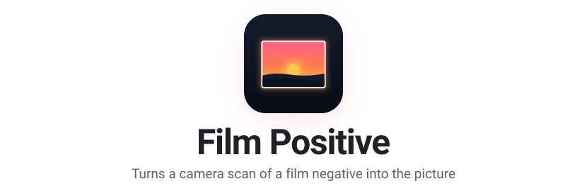
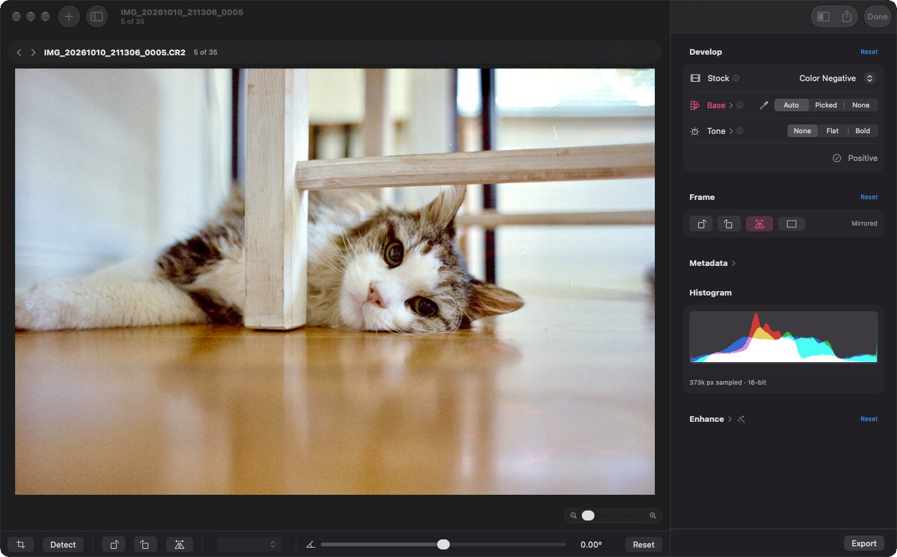

<p align="center">
  <picture>
    <source media="(prefers-color-scheme: dark)" srcset="assets/readme/header-dark.svg">
    
  </picture>
</p>

<p align="center">
  <a href="https://filmpositive.app">Website</a>
  &nbsp;&middot;&nbsp;
  <a href="https://github.com/chriscantey/film-positive/releases/latest">Download</a>
  &nbsp;&middot;&nbsp;
  <a href="https://filmtether.app">See Film Tether</a>
</p>

A native macOS app that turns a camera scan of a film negative into the picture.

It reads the raw files from a camera scan of your negatives, color or black and white, and develops each frame into a positive you can export. It's the other half of how I scan film at home, after [Film Tether](https://filmtether.app) captures the frame.

There are lots of apps that do this, with more coming along all the time. I built this one around how I like to work, and maybe you'll like it too. It's a native Mac app built on Apple's own frameworks, and it should run well on most Macs. The idea is a short, simple path from scanned negatives to positives, with a lot more options there when you want them.

For most of my scans I keep the general color profile with Auto Color, let Detect Crop find the edges, check the crops, and then export to finish in another app, if I haven't already made the corrections I want right here.

Open source, GPL-3.0, macOS 14+.

<p align="center">
  
</p>

## What it does

For most frames a slider or two gets you most of the way, say for tungsten film shot in daylight, and the rest of the controls are there for the roll that needs more.

- **Auto Color.** Tries to read the film base from the frame itself. If you'd rather choose, Pick Film Color lets you click the clear film between frames.
- **Three tones.** Besides None, Flat and Bold give you a couple of options for where a frame starts before you edit it. You may not need either, and None with Auto Color may be all you want.
- **Looks and sliders.** After develop, Looks are one-tap presets of the enhancement sliders: exposure, highlights and shadows, warmth and tint, sharpness, halation, and more. You can save your own and export them.
- **Crop and straighten.** Detect Crop finds the film edge across a selection, with the aspect ratio picked up front. Nothing crops or rotates on its own. Straighten and quarter turns are there when you need them.
- **Export.** One frame or a whole selection, to 16-bit TIFF or PNG, HEIC, AVIF, JPEG, or JPEG XL, in sRGB or Display P3, with the color profile embedded.
- **Small, plain files.** Each frame's settings live in an XMP sidecar next to the scan, the same file [Film Tether](https://filmtether.app) writes, and anything else in that file is kept as it was.

If you scan with [Film Tether](https://filmtether.app) and tell it which film stock is in the holder, that name travels with the frame. Every frame still opens on the general color negative profile, and you pick a stock when you want its curve.

## How it develops a negative

A camera scan of a color negative is a picture of the film base, orange on most color film, with a darker image on it. Film Positive works out how bright and how orange that bare film is, then measures every pixel against it, and that measurement becomes the positive.

Where a film maker publishes a characteristic curve for a stock, the app uses the dye gammas from that sheet, so the numbers that describe each film come from the maker rather than from my light or my camera. Each stock is a small JSON profile, and you can import new ones from Settings.

## Caveats

- I've only tested it with Canon raw files from a small set of cameras.
- Color is still being tuned against real film datasheets and my own tests, so results can shift between releases, though for the most part things should be fairly stable now.
- So far, a stock gets its own profile only when its maker publishes a characteristic curve for it. Everything else goes through a general color negative profile for now (almost any color negative should work with it, even the ones that have their own curve).
- There's no dust and scratch removal yet. It's on the roadmap below.

It sticks to turning negative scans into positives, with editing if you want it. Driving the camera during the scan is [Film Tether](https://filmtether.app)'s job.

## Roadmap

With no specific timeline, this is roughly the order I expect things to land.

- **A profile editor in Settings,** so you can make a film profile, adjust its dye gammas, and see what changed without opening a text editor.
- **More custom stocks, as I test them.** These are profiles I measure myself from a color chart shot on a known setup, for films with no published curve.
- **Dust and scratch removal** that works from the image alone, since a camera scan has no infrared channel, plus a brush for anything it misses.

## Requirements

- macOS 14 (Sonoma) or newer, Apple Silicon or Intel.
- Camera scans of your negatives as raw files, one frame per file.
- Color or black and white negatives.
- Ideally some film border around each frame, or a scan of a blank stretch of the roll, so the app can read the film base.

## Install

Grab the latest build from [Releases](https://github.com/chriscantey/film-positive/releases), unzip it, and open it.

If you let it (Settings > Updates), the app checks filmpositive.app once a day for a new version. It's a standard HTTPS request with a User-Agent header like `Film Positive/0.1.0 Sparkle/2.10.0`, and nothing else. As with any web request, the server can see your IP address.

## Build from source

Building needs a Mac with Xcode, plus CMake for libjxl. The app links two libraries pinned to exact versions, LibRaw 0.21.4 and libjxl 0.12.0. The pin matters for LibRaw in particular, because Homebrew's LibRaw has moved on to 0.22, which the decode path does not accept.

`tools/build-libraw-mac.sh` downloads LibRaw, checks the tarball against a pinned checksum, and builds it for both architectures under `~/build/deps`. `tools/build-libjxl-mac.sh` builds a static libjxl the same way, from a clone of the libjxl repository at `~/build/deps/libjxl`. Then, on Apple Silicon:

```bash
export FP_LIBRAW_PREFIX=~/build/deps/libraw-0.21.4-arm64
export FP_LIBJXL_PREFIX=~/build/deps/libjxl-0.12.0-arm64
swift build -c release --product FilmPositive
FP_BUILD_DIR=.build/release tools/bundle-app.sh
```

On an Intel Mac the prefixes end in `-x86` and `-x86_64`. `tools/bundle-app.sh` wraps the build into an app bundle under `~/build/Film Positive`, with LibRaw and the film profiles inside it.

The tests run with `swift test`, using the same two prefixes.

`film-sidecar`, the small Swift package that reads and writes the sidecar both apps share, is included under `Vendor/film-sidecar`.

## License

GPL-3.0. See [LICENSE](LICENSE). `film-sidecar` is MIT, see its own license file under `Vendor/film-sidecar`.

## Credits

Film Positive uses three open-source libraries:

- [LibRaw](https://www.libraw.org) reads the camera raw files. It is LGPL 2.1 or CDDL, and the app links it dynamically.
- [libjxl](https://github.com/libjxl/libjxl) writes JPEG XL. It is BSD-3-Clause, and the app links it statically, along with the highway, brotli and skcms libraries it builds with.
- [Sparkle](https://sparkle-project.org) checks for and installs updates. It is MIT (`licenses/sparkle-LICENSE.txt`).

The crop detection and straightening came over from [Film Tether](https://filmtether.app), where Alex Teslik contributed the original crop work.

Made with a lot of help from [my AI assistant](https://chriscantey.com/posts/2026-02-24-build-or-buy-may-have-changed/).

Canon is a trademark of Canon Inc. This is a personal project and is not affiliated with Canon or any film maker.
